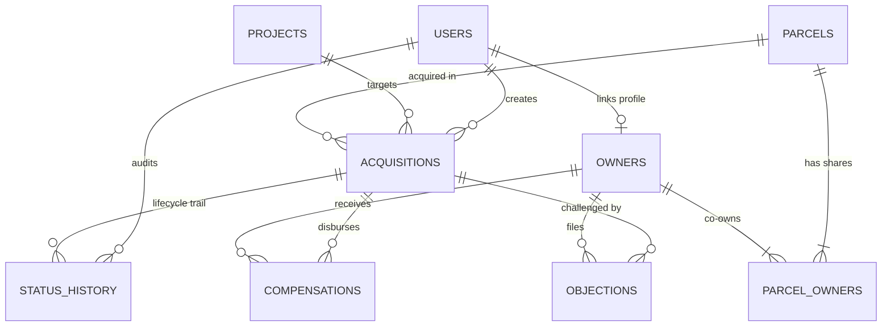

# 🏛️ Real-Time System for Land Acquisition & Management

> **Course:** Advanced Programming / Data Engineering (AP DE 2026)  
> **Team AYMK:** Aastik (Lead), Yashmeet, Mann, Krishna  
> **Stack:** Node.js, Express.js, Prisma ORM, SQLite

---

## 🌟 1. Project Overview

The **Real-Time System for Land Acquisition** is a robust, transparent, and event-driven backend system designed for government revenue departments, infrastructure agencies (e.g., NHAI, Metro, Irrigation), and citizen landowners.

It automates the complete lifecycle of public land acquisition:
1. **Cadastral Land Parcel & Ownership Registry** (including co-ownership percentages).
2. **Infrastructure Project Earmarking & Budgeting**.
3. **5-Stage Acquisition Workflow Engine**:
   $$\text{PROPOSED} \longrightarrow \text{NOTIFIED} \longrightarrow \text{VALUATED} \longrightarrow \text{COMPENSATED} \longrightarrow \text{COMPLETED}$$
4. **Automated Landowner Compensation Valuation**:
   $$\text{Compensation Amount} = \text{Area (sqm)} \times \text{Circle Rate (₹/sqm)} \times \left(\frac{\text{Share } \%}{100}\right)$$
5. **Citizen Grievance Redressal (Objections)** with status tracking.
6. **Immutable Audit Trail (`status_history`)** ensuring legal transparency.
7. **Real-Time Event Broadcasting (SSE + Node.js EventEmitter)** to update all connected dashboards and stakeholders without polling.

---

## 📚 2. Lecture Topics & Code Mapping

This backend is organized around the topics shown in the AP syllabus screenshot:

| Lecture Topic Covered | Implementation in Code |
|:---|:---|
| **Client-Server Architecture & HTTP Methods** | Standard REST methods (`GET`, `POST`, `PUT`, `PATCH`, `DELETE`) with exact HTTP status codes (`200 OK`, `201 Created`, `400 Bad Request`, `401 Unauthorized`, `403 Forbidden`, `404 Not Found`, `409 Conflict`). |
| **Serialization & API Headers** | JSON serialization across all responses (`src/utils/apiResponse.js`), custom headers (`Authorization: Bearer <token>`, `Idempotency-Key`, `X-Cache-Lookup`). |
| **Node.js Core (Event Loop, Libuv, Non-blocking I/O)** | Fully asynchronous, non-blocking I/O using async/await with Prisma client and native HTTP event loops. |
| **EventEmitter & Observer Pattern** | Decoupled domain event bus (`src/services/eventBus.js`) emitting `acquisition:status_changed`, `compensation:paid`, and `objection:filed`. |
| **Streams & Real-Time Delivery** | Server-Sent Events (SSE) persistent stream (`/api/v1/realtime/stream` in `src/controllers/realtimeController.js`) streaming events over HTTP response streams. |
| **Express.js & MVC Architecture** | Modular separation into Controllers (`src/controllers`), Models (`prisma/schema.prisma`), Routes (`src/routes`), Middlewares (`src/middlewares`), and Services. |
| **Express Middlewares** | Custom logging middleware (`src/middlewares/loggerMiddleware.js`), centralized error handler (`errorMiddleware.js`), cookie parser, CORS, and body parser. |
| **Idempotency** | In-memory cache middleware (`src/middlewares/idempotencyMiddleware.js`) inspecting `Idempotency-Key` headers on financial compensation disbursements to prevent duplicate payments. |
| **Static Routes** | Express static route serving interactive web dashboard at `/` from `public/index.html`. |
| **REST APIs & API Versioning** | Unified under `/api/v1` with resource-oriented URLs (`/api/v1/projects`, `/api/v1/parcels`, `/api/v1/acquisitions`, `/api/v1/compensations`, `/api/v1/objections`). |
| **Prisma ORM & Data Models** | Full relational schema matching `dbms/03_schema.sql` (`prisma/schema.prisma`) with SQLite default and PostgreSQL compatibility. |
| **Prisma Database Relations** | 1-to-Many (`Project` -> `Acquisitions`), Many-to-Many (`Parcels` <-> `Owners` via `ParcelOwner` junction table), and 1-to-1 (`User` <-> `Owner`). |
| **Prisma CRUD & Seeding** | Complete CRUD operations with relational filters and automated seed script (`prisma/seed.js`) loading verified government test records. |
| **Authentication (Token vs Session & Persistence)** | Dual-mode authentication: Bearer JWT in `Authorization` header for API clients, and HTTP-Only persistent cookie (`auth_token`) for web browsers (`src/utils/token.js`). |
| **Authorisation & RBAC (Role-Based Access Control)** | Role middleware (`src/middlewares/roleMiddleware.js`) gives administrators management access and landowners access to their own records and queries. |

---

## 🗄️ 3. Database Architecture & Relations



---

## 🚀 4. Quick Start & Setup

### Prerequisites
- Node.js (v18.0.0 or higher)
- npm (v9.0.0 or higher)

### Step 1: Install Dependencies
```bash
npm install
```

### Step 2: Initialize Database with Prisma
```bash
# Push schema to SQLite database (creates prisma/dev.db)
npm run prisma:push

# Populate database with government sample records
npm run seed
```

### Step 3: Start the Backend Server
```bash
# Production start
npm start

# Or Development mode (auto-reload on changes)
npm run dev
```

The server will launch at: **`http://localhost:5000`**

Open **`http://localhost:5000`** in your browser to use the included frontend. Express serves the page from `public/`; it calls this server's `/api/v1` routes, so a separate frontend server is not needed. On a fresh copy, create `.env` from `.env.example` before database setup.

---

## 🧪 5. Testing the System

### 1. Interactive Web Dashboard
Open your web browser and visit:
👉 **`http://localhost:5000`**

Features available in the web dashboard:
- **Real-Time Live Event Stream**: See status changes, payments, and objections appear live via SSE.
- **Demo Sign-in**: 1-click login as Admin or Landowner.
- **Workflow Advancement**: Progress acquisitions from `PROPOSED` $\to$ `COMPLETED`.
- **Idempotent Payouts**: Disburse landowner compensation with idempotency protection.

### 2. Automated Smoke Test Suite
Run the automated test suite verifying all lecture topics (Auth, RBAC, Idempotency, Workflow Transitions):
```bash
npm test
```

---

## 🔑 6. Default Test Accounts

| Role | Name | Email | Password | Allowed Permissions |
|:---|:---|:---|:---|:---|
| **ADMIN** | Admin Sharma | `admin@ap.gov.in` | `password123` | Full system access, project budget creation, user role updates. |
| **OWNER** | Suresh Reddy | `suresh@gmail.com` | `password123` | View owned parcels, view compensations, file dispute grievances/objections. |

---

## 📡 7. API Reference (`/api/v1`)

### 🔐 Authentication (`/api/v1/auth`)
- `POST /register`: Register a new user account (optional landowner ID link).
- `POST /login`: Authenticate with email and password (returns Bearer JWT and sets HTTP-only cookie).
- `POST /logout`: Clear session cookie.
- `GET /me`: Get current authenticated user details (`Bearer <token>`).

### 🏗️ Projects (`/api/v1/projects`)
- `GET /`: List all infrastructure projects.
- `GET /:id`: Get project details with committed compensation totals.
- `POST /`: Create project (`ADMIN`).
- `PUT /:id`: Update project budget or details (`ADMIN`).
- `DELETE /:id`: Delete project if no active acquisitions (`ADMIN`).

### 🏞️ Cadastral Parcels (`/api/v1/parcels`)
- `GET /`: List parcels with circle rates, valuation, and owners. Filter by `village`, `minArea`, `maxRate`.
- `GET /:id`: Get single parcel details with owners and acquisition records.
- `POST /`: Register land parcel (`ADMIN`).
- `POST /:id/owners`: Assign or update ownership percentage share (0.01% - 100%).
- `GET /owners/list`: List all registered citizen landowners.

### 📋 Acquisition Workflow Engine (`/api/v1/acquisitions`)
- `GET /`: List acquisitions with relational filters (`status`, `projectId`, `village`).
- `GET /:id`: Get acquisition with full audit history and related vouchers.
- `POST /`: Initiate land acquisition workflow (`PROPOSED`).
- `PATCH /:id/status`: Advance workflow stage (`NOTIFIED`, `VALUATED`, `COMPENSATED`, `COMPLETED`).
  - *Automated Rule:* Moving to `VALUATED` automatically calculates and creates compensation records for each co-owner.
  - *Automated Rule:* Moving to `COMPLETED` requires all objections to be resolved and all compensations to be paid!

### 💰 Compensations & Disbursements (`/api/v1/compensations`)
- `GET /`: List compensation vouchers (citizens see only their own).
- `POST /:id/pay`: Disburse compensation payment (`ADMIN`).
  - **Idempotency Protection:** Pass header `Idempotency-Key: <unique-key>`. Duplicate requests return cached response with `X-Cache-Lookup: HIT`.

### ⚖️ Citizen Grievances & Objections (`/api/v1/objections`)
- `GET /`: List grievances with filter by `status` (`OPEN`, `UNDER_REVIEW`, `RESOLVED`, `REJECTED`).
- `POST /`: A landowner files a query for an acquisition linked to a parcel they own (`OWNER`). The backend verifies ownership and stores it as `OPEN`.
- `PATCH /:id/status`: Admin moves the query to `UNDER_REVIEW`, then records `RESOLVED` or `REJECTED`.

Query lifecycle: **Landowner submits → OPEN → Admin reviews → UNDER_REVIEW → RESOLVED or REJECTED**. An acquisition cannot be marked `COMPLETED` while a related query is `OPEN` or `UNDER_REVIEW`, or while compensation remains unpaid. The landowner can see the status of their own query after signing in; Admin can review all queries.

### ⚡ Real-Time Server-Sent Events (`/api/v1/realtime`)
- `GET /stream`: Persistent HTTP stream broadcasting domain events in real-time.
  ```bash
  curl -N http://localhost:5000/api/v1/realtime/stream
  ```

---

## 👥 8. Team AYMK (Advanced Programming 2026)
- **Aastik** (Group Lead) — *Enrollment: 2501010008*
- **Yashmeet** — *Enrollment: 2501010525*
- **Mann** — *Enrollment: 2501010260*
- **Krishna Sharma** — *Enrollment: 2501010234*
