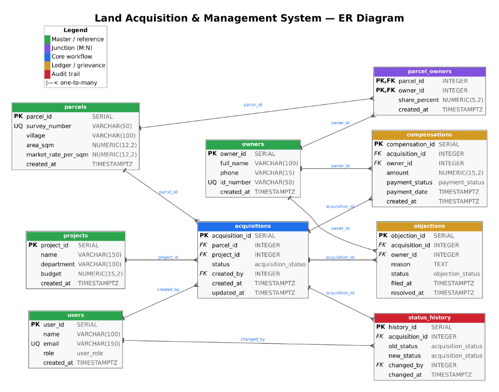
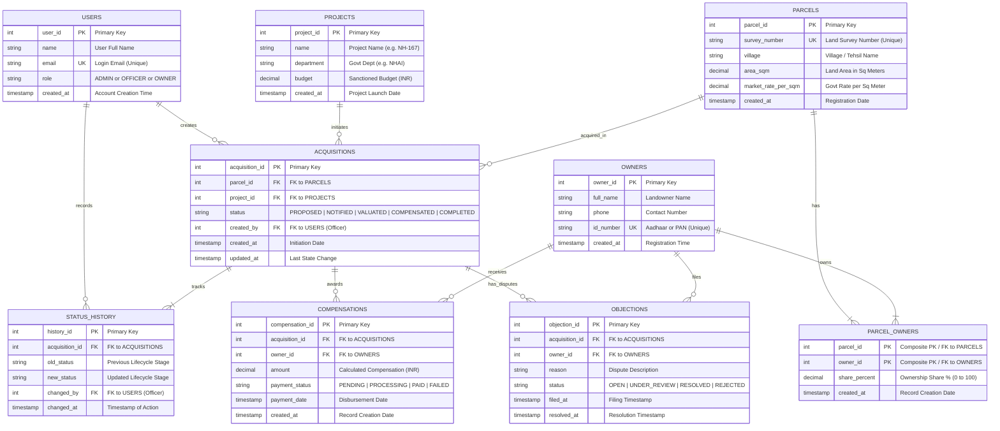

# Entity-Relationship (ER) Diagram (Made Super Easy! 🚀)
**Project:** Real-Time Land Acquisition & Management System  
**Level:** Beginner / Newbie Friendly  

---

## 💡 1. What is an ER Diagram? (The "Architectural Blueprint" Analogy)

In [`01_normalization.md`](01_normalization.md), we took a messy laundry basket of land records and organized it into **9 tidy drawers** (tables).

Now, before a builder constructs a house, they don't just dump bricks on the ground — they look at an **Architectural Blueprint**.  
An **Entity-Relationship (ER) Diagram** is the blueprint for your database:
- It shows **what boxes exist** (Entities/Tables).
- It shows **what details each box holds** (Attributes/Columns).
- It shows **how the boxes connect to one another** (Relationships/Foreign Keys).

```
   ┌──────────┐              owns (1:N)             ┌───────────────┐
   │  OWNERS  │ ──────────────────────────────────> │ PARCEL_OWNERS │
   └──────────┘                                     └───────────────┘
   (Who owns it?)                                     (What share?)
```

### The 4 Core Building Blocks:
1. **Entity (Noun / Table):** A real-world thing we store data about.  
   *Examples:* `users`, `owners`, `parcels`, `projects`.
2. **Attribute (Adjective / Column):** A detail describing that entity.  
   *Examples:* `village`, `area_sqm`, `phone`, `budget`.
3. **Primary Key (PK - The Aadhaar Card):** A column that guarantees every single row is unique.  
   *Examples:* `parcel_id`, `owner_id`.
4. **Foreign Key (FK - The Remote Control Link):** A column in Table B that points directly to the Primary Key of Table A so they can talk.  
   *Examples:* `acquisitions.parcel_id` points back to `parcels.parcel_id`.

---

## 🗺️ 2. The Complete System ER Diagram

Here is the visual map of all **9 normalized tables** in our Land Acquisition system.

### Visual Architecture Diagram:


*(Also available as vector graphic in [`02_er_diagram.svg`](02_er_diagram.svg))*

> 💡 *Note: If you are browsing on GitHub, the interactive Mermaid diagram below is also rendered automatically!*

### Interactive GitHub Mermaid ER Diagram:



---

## 🏛️ 3. High-Level System Architecture (4 Core Domains)

To make this crystal clear for any beginner, the 9 tables are grouped into **4 natural subsystems**:

```
 ┌────────────────────────────────────────────────────────────────────────┐
 │                     1. IDENTITY & AUTHENTICATION                       │
 │  [ users ] : System Officers & Administrators logging in.              │
 └───────────────────────────────────┬────────────────────────────────────┘
                                     │ (audits & acts upon)
 ┌───────────────────────────────────▼────────────────────────────────────┐
 │                     2. LAND & OWNERSHIP REGISTRY                       │
 │  [ parcels ] ◄─────── [ parcel_owners ] ────────► [ owners ]           │
 │  (Land Records)       (Bridge: Share %)          (Citizens)            │
 └───────────────────────────────────┬────────────────────────────────────┘
                                     │ (selected for acquisition)
 ┌───────────────────────────────────▼────────────────────────────────────┐
 │                     3. ACQUISITION WORKFLOW ENGINE                     │
 │  [ projects ] ───────► [ acquisitions ] ◄─────── [ status_history ]    │
 │  (Govt Scheme)         (Heart: 5 Stages)          (Audit Trail)        │
 └───────────────────────────────────┬────────────────────────────────────┘
                                     │ (generates payouts & grievances)
 ┌───────────────────────────────────▼────────────────────────────────────┐
 │                     4. FINANCIALS & GRIEVANCES                         │
 │  [ compensations ] : Calculated payout per landowner based on share %  │
 │  [ objections ]    : Grievance complaints filed by landowners          │
 └────────────────────────────────────────────────────────────────────────┘
```

---

## 🔢 4. Cardinality Explained (Crow's Foot Notation for Beginners)

When two tables are connected, **cardinality** tells you *"How many rows in Table A match rows in Table B?"*

| Symbol | Notation Name | Meaning in Plain English | Real-World Example |
|:---:|:---|:---|:---|
| `||--||` | **One-to-One (1:1)** | Exactly one row links to exactly one row. | A citizen has exactly one Aadhaar profile. |
| `||--o{` | **One-to-Many (1:N)** | One row can link to zero, one, or many rows. | One project has many land acquisitions. |
| `||--|{` | **One-to-Mandatory-Many** | One row must link to at least one row. | A parcel must have at least one owner. |
| `}o--o{` | **Many-to-Many (M:N)** | Many rows link to many rows. *(Forbidden directly!)* | Parcels & Owners (needs a bridge table). |

---

### 💡 Why do we need the `parcel_owners` Bridge Table?

Look at the real world:
1. One piece of land can be co-owned by 3 brothers: **One parcel &rarr; Multiple owners**.
2. One farmer can own 4 different fields in different villages: **One owner &rarr; Multiple parcels**.

In relational databases, **you cannot link two tables directly with Many-to-Many** without creating severe duplication (violating 1NF and 2NF).  
So we insert a **Bridge (Junction) Table** called `parcel_owners`:

```
   [ parcels ]                 [ parcel_owners ]                 [ owners ]
   ┌─────────┐   1 : N (has)   ┌─────────────────┐  N : 1 (owns) ┌────────┐
   │ P-101   │ ──────────────> │ P-101 + Suresh  │ <──────────── │ Suresh │
   │ P-102   │                 │ P-101 + Ramesh  │ <──────────── │ Ramesh │
   └─────────┘                 │ P-102 + Venkat  │ <──────────── │ Venkat │
                               └─────────────────┘               └────────┘
```

Now, instead of one messy $M:N$ connection, we have **two clean $1:N$ connections**!  
Plus, `parcel_owners` stores the exact `share_percent` (e.g., 60% and 40%).

---

### 📋 Full Relationship Dictionary:

| Parent Table | Relationship | Child Table | Cardinality | Why this rule exists? |
|:---|:---:|:---|:---:|:---|
| `users` | **creates** | `acquisitions` | `1 : N` | One officer can create multiple acquisition cases. Every case tracks who created it. |
| `users` | **logs** | `status_history` | `1 : N` | Every workflow status change records the officer who approved it. |
| `projects` | **initiates** | `acquisitions` | `1 : N` | A government project (e.g., Highway NH-167) acquires multiple land parcels along its route. |
| `parcels` | **divided into** | `parcel_owners` | `1 : N` | A land parcel can have one or more registered co-owners. |
| `owners` | **holds share** | `parcel_owners` | `1 : N` | A citizen can own shares in one or multiple land parcels. |
| `parcels` | **subject of** | `acquisitions` | `1 : N` | A parcel is earmarked for acquisition under a project. |
| `acquisitions` | **audit tracks**| `status_history` | `1 : N` | Every step in an acquisition's lifecycle is permanently recorded. |
| `acquisitions` | **awards** | `compensations` | `1 : N` | An acquisition generates compensation payouts for every co-owner of the land. |
| `owners` | **receives** | `compensations` | `1 : N` | Each owner receives their proportional share of the compensation money. |
| `acquisitions` | **disputed by** | `objections` | `1 : N` | Landowners can raise formal grievances against an acquisition. |
| `owners` | **files** | `objections` | `1 : N` | An owner can submit one or more objections (e.g., dispute over valuation rate). |

---

## 📦 5. The 9 Entities Deep Dive (Data Dictionary)

Here are the complete specifications of all 9 entities, matching the normalization work done in `01_normalization.md`.

---

### 1. `users` (System Accounts)
*Stores officers and administrators who manage land acquisition.*

| Column | Data Type | Constraint | Description | Example |
|:---|:---|:---|:---|:---|
| `user_id` | `INTEGER` | `PRIMARY KEY AUTOINCREMENT` | Unique internal user ID | `1` |
| `name` | `VARCHAR(100)` | `NOT NULL` | Full name of the officer/staff | `Officer Ravi` |
| `email` | `VARCHAR(150)` | `NOT NULL UNIQUE` | Official email login | `ravi@ap.gov.in` |
| `role` | `VARCHAR(20)` | `NOT NULL CHECK (role IN ('ADMIN', 'OFFICER', 'OWNER'))` | System access role | `OFFICER` |
| `created_at` | `TIMESTAMP` | `DEFAULT CURRENT_TIMESTAMP` | Account registration time | `2026-11-16 09:00:00` |

---

### 2. `owners` (Landowners Registry)
*Stores citizens who legally own land parcels.*

| Column | Data Type | Constraint | Description | Example |
|:---|:---|:---|:---|:---|
| `owner_id` | `INTEGER` | `PRIMARY KEY AUTOINCREMENT` | Unique owner ID | `10` |
| `full_name` | `VARCHAR(100)` | `NOT NULL` | Name of the landowner | `Suresh Reddy` |
| `phone` | `VARCHAR(15)` | `NOT NULL` | Mobile number for SMS alerts | `9848011111` |
| `id_number` | `VARCHAR(50)` | `NOT NULL UNIQUE` | National ID (Aadhaar / PAN) | `ID-901` |
| `created_at` | `TIMESTAMP` | `DEFAULT CURRENT_TIMESTAMP` | Record creation date | `2026-11-16 09:15:00` |

---

### 3. `parcels` (Land Cadastral Registry)
*Stores registered plots of land with official survey numbers and government valuation.*

| Column | Data Type | Constraint | Description | Example |
|:---|:---|:---|:---|:---|
| `parcel_id` | `INTEGER` | `PRIMARY KEY AUTOINCREMENT` | Unique parcel ID | `1` |
| `survey_number` | `VARCHAR(50)` | `NOT NULL UNIQUE` | Official revenue survey number | `P-101` |
| `village` | `VARCHAR(100)` | `NOT NULL` | Village or municipality name | `Nandyal` |
| `area_sqm` | `DECIMAL(12,2)` | `NOT NULL CHECK (area_sqm > 0)` | Total land area in square meters | `10000.00` |
| `market_rate_per_sqm` | `DECIMAL(12,2)` | `NOT NULL CHECK (market_rate_per_sqm > 0)` | Circle rate per sq meter (INR) | `500.00` |
| `created_at` | `TIMESTAMP` | `DEFAULT CURRENT_TIMESTAMP` | Date parcel was registered | `2026-11-16 09:20:00` |

---

### 4. `parcel_owners` (Ownership Shares Bridge)
*Resolves the Many-to-Many link between parcels and owners, storing the legal ownership percentage.*

| Column | Data Type | Constraint | Description | Example |
|:---|:---|:---|:---|:---|
| `parcel_id` | `INTEGER` | `REFERENCES parcels(parcel_id) ON DELETE CASCADE` | Foreign Key to parcel | `1` |
| `owner_id` | `INTEGER` | `REFERENCES owners(owner_id) ON DELETE CASCADE` | Foreign Key to owner | `10` |
| `share_percent` | `DECIMAL(5,2)` | `NOT NULL CHECK (share_percent > 0 AND share_percent <= 100)` | Legal ownership % | `60.00` |
| `created_at` | `TIMESTAMP` | `DEFAULT CURRENT_TIMESTAMP` | Record timestamp | `2026-11-16 09:30:00` |
| **PRIMARY KEY** | `(parcel_id, owner_id)` | `COMPOSITE PRIMARY KEY` | Prevents duplicate ownership records for the same parcel | — |

---

### 5. `projects` (Government Infrastructure Schemes)
*Stores public works schemes requiring land acquisition.*

| Column | Data Type | Constraint | Description | Example |
|:---|:---|:---|:---|:---|
| `project_id` | `INTEGER` | `PRIMARY KEY AUTOINCREMENT` | Unique project ID | `100` |
| `name` | `VARCHAR(150)` | `NOT NULL` | Project title | `Highway NH-167` |
| `department` | `VARCHAR(100)` | `NOT NULL` | Sponsoring department | `NHAI` |
| `budget` | `DECIMAL(15,2)` | `NOT NULL CHECK (budget >= 0)` | Allocated acquisition fund | `50000000.00` (₹5 Cr) |
| `created_at` | `TIMESTAMP` | `DEFAULT CURRENT_TIMESTAMP` | Project launch timestamp | `2026-11-16 09:00:00` |

---

### 6. `acquisitions` (The Central Workflow Engine)
*The heart of the entire system: links a parcel to a project and drives it through the acquisition stages.*

| Column | Data Type | Constraint | Description | Example |
|:---|:---|:---|:---|:---|
| `acquisition_id` | `INTEGER` | `PRIMARY KEY AUTOINCREMENT` | Unique acquisition case ID | `501` |
| `parcel_id` | `INTEGER` | `NOT NULL REFERENCES parcels(parcel_id) ON DELETE RESTRICT` | Target parcel | `1` |
| `project_id` | `INTEGER` | `NOT NULL REFERENCES projects(project_id) ON DELETE RESTRICT` | Sponsoring project | `100` |
| `status` | `VARCHAR(30)` | `NOT NULL DEFAULT 'PROPOSED' CHECK (status IN ('PROPOSED', 'NOTIFIED', 'VALUATED', 'COMPENSATED', 'COMPLETED'))` | Current lifecycle state | `VALUATED` |
| `created_by` | `INTEGER` | `NOT NULL REFERENCES users(user_id) ON DELETE RESTRICT` | Officer handling case | `1` |
| `created_at` | `TIMESTAMP` | `DEFAULT CURRENT_TIMESTAMP` | Date initiated | `2026-11-16 10:00:00` |
| `updated_at` | `TIMESTAMP` | `DEFAULT CURRENT_TIMESTAMP` | Last status change | `2026-11-16 14:30:00` |
| **CONSTRAINT** | `UNIQUE(parcel_id, project_id)` | Prevents acquiring the same parcel twice for the same project | — |

---

### 7. `compensations` (Calculated Payout per Landowner)
*Financial ledger tracking how much money is owed to each owner, calculated automatically.*

$$\text{Amount} = \text{area\_sqm} \times \text{market\_rate\_per\_sqm} \times \left(\frac{\text{share\_percent}}{100}\right)$$

| Column | Data Type | Constraint | Description | Example |
|:---|:---|:---|:---|:---|
| `compensation_id` | `INTEGER` | `PRIMARY KEY AUTOINCREMENT` | Unique compensation ID | `1` |
| `acquisition_id` | `INTEGER` | `NOT NULL REFERENCES acquisitions(acquisition_id) ON DELETE CASCADE` | Link to acquisition | `501` |
| `owner_id` | `INTEGER` | `NOT NULL REFERENCES owners(owner_id) ON DELETE CASCADE` | Beneficiary owner | `10` |
| `amount` | `DECIMAL(15,2)` | `NOT NULL CHECK (amount >= 0)` | Calculated amount in INR | `3000000.00` (₹30 Lakh) |
| `payment_status` | `VARCHAR(20)` | `NOT NULL DEFAULT 'PENDING' CHECK (payment_status IN ('PENDING', 'PROCESSING', 'PAID', 'FAILED'))` | Disbursement status | `PENDING` |
| `payment_date` | `TIMESTAMP` | `NULL` | Timestamp when paid | `NULL` |
| `created_at` | `TIMESTAMP` | `DEFAULT CURRENT_TIMESTAMP` | Date computed | `2026-11-16 14:30:00` |
| **CONSTRAINT** | `UNIQUE(acquisition_id, owner_id)` | Ensures each owner gets exactly one compensation voucher per acquisition | — |

---

### 8. `objections` (Disputes & Grievance Redressal)
*Tracks complaints raised by owners that could halt or amend the acquisition.*

| Column | Data Type | Constraint | Description | Example |
|:---|:---|:---|:---|:---|
| `objection_id` | `INTEGER` | `PRIMARY KEY AUTOINCREMENT` | Unique dispute ID | `1` |
| `acquisition_id` | `INTEGER` | `NOT NULL REFERENCES acquisitions(acquisition_id) ON DELETE CASCADE` | Disputed acquisition | `501` |
| `owner_id` | `INTEGER` | `NOT NULL REFERENCES owners(owner_id) ON DELETE CASCADE` | Owner who filed dispute | `10` |
| `reason` | `TEXT` | `NOT NULL` | Description of the grievance | `"Compensation rate too low"` |
| `status` | `VARCHAR(20)` | `NOT NULL DEFAULT 'OPEN' CHECK (status IN ('OPEN', 'UNDER_REVIEW', 'RESOLVED', 'REJECTED'))` | Dispute status | `OPEN` |
| `filed_at` | `TIMESTAMP` | `DEFAULT CURRENT_TIMESTAMP` | Date grievance filed | `2026-11-16 15:00:00` |
| `resolved_at` | `TIMESTAMP` | `NULL` | Date of legal settlement | `NULL` |

---

### 9. `status_history` (Immutable Audit Trail)
*Keeps a tamper-proof record of every status transition for legal and administrative compliance.*

| Column | Data Type | Constraint | Description | Example |
|:---|:---|:---|:---|:---|
| `history_id` | `INTEGER` | `PRIMARY KEY AUTOINCREMENT` | Unique audit log ID | `1` |
| `acquisition_id` | `INTEGER` | `NOT NULL REFERENCES acquisitions(acquisition_id) ON DELETE CASCADE` | Target acquisition | `501` |
| `old_status` | `VARCHAR(30)` | `NULL` | Previous stage | `PROPOSED` |
| `new_status` | `VARCHAR(30)` | `NOT NULL` | Transitioned stage | `NOTIFIED` |
| `changed_by` | `INTEGER` | `NOT NULL REFERENCES users(user_id) ON DELETE RESTRICT` | Officer who authorized | `1` (Officer Ravi) |
| `changed_at` | `TIMESTAMP` | `DEFAULT CURRENT_TIMESTAMP` | Exact timestamp | `2026-11-16 10:00:00` |

---

## 🔄 6. The Real-Time Acquisition Lifecycle

How does data move across these entities during a real government acquisition?

```
   [ PROPOSED ] 
        │  Officer enters the parcel into the acquisition pipeline.
        ▼
   [ NOTIFIED ] 
        │  Public notice published; owners alerted; objections window opens.
        ▼
   [ VALUATED ] 
        │  Land surveyed; compensation calculated per owner (area × rate × share%).
        ▼
   [ COMPENSATED ] 
        │  Disbursement completed; all open objections resolved.
        ▼
   [ COMPLETED ] 
           Land title legally transferred to government project.
```

### Safety & Integrity Rules during the Workflow:
1. **Grievance Gate:** An acquisition cannot transition to `COMPLETED` if there is an unresolved `objection` with `status = 'OPEN'`.
2. **Compensation Gate:** An acquisition cannot transition to `COMPLETED` until all `compensations` records have `payment_status = 'PAID'`.
3. **Audit Guarantee:** Every transition from state $A \rightarrow B$ creates an append-only entry in `status_history`.

---

## 🛡️ 7. Integrity Constraints Checklist

| Constraint Type | Table | Columns | Purpose |
|:---|:---|:---|:---|
| **Composite PK** | `parcel_owners` | `(parcel_id, owner_id)` | Eliminates duplicate ownership records for the same land parcel. |
| **Unique Key (UK)** | `users` | `email` | Ensures each staff member has a single unique login email. |
| **Unique Key (UK)** | `owners` | `id_number` | Guarantees citizen identification (Aadhaar / PAN) is unique. |
| **Unique Key (UK)` | `parcels` | `survey_number` | Guarantees land registry records never collide. |
| **Unique Key (UK)` | `acquisitions` | `(parcel_id, project_id)` | Prevents initiating multiple duplicate acquisitions for the same parcel on the same project. |
| **Check Range** | `parcel_owners` | `share_percent` | Must be $> 0$ and $\le 100$. |
| **Check Positive** | `parcels` | `area_sqm`, `market_rate_per_sqm` | Land area and circle rates must always be strictly positive numbers. |
| **Check Status** | `acquisitions` | `status` | Constrained to valid enum values (`PROPOSED`, `NOTIFIED`, `VALUATED`, `COMPENSATED`, `COMPLETED`). |

---

## 🚀 8. Summary & Next Step

We now have:
- ✅ **`01_normalization.md`**: Step-by-step mathematical normalization from 0NF to 3NF/BCNF.
- ✅ **`02_er_diagram.*`**: Complete entity relationship diagram, visual SVG, and full data dictionary.

👉 **Next Step:** Head over to [`03_schema.sql`](03_schema.sql) to view and execute the complete SQL DDL script, complete with tables, foreign key constraints, performance indexes, and sample seed data!
